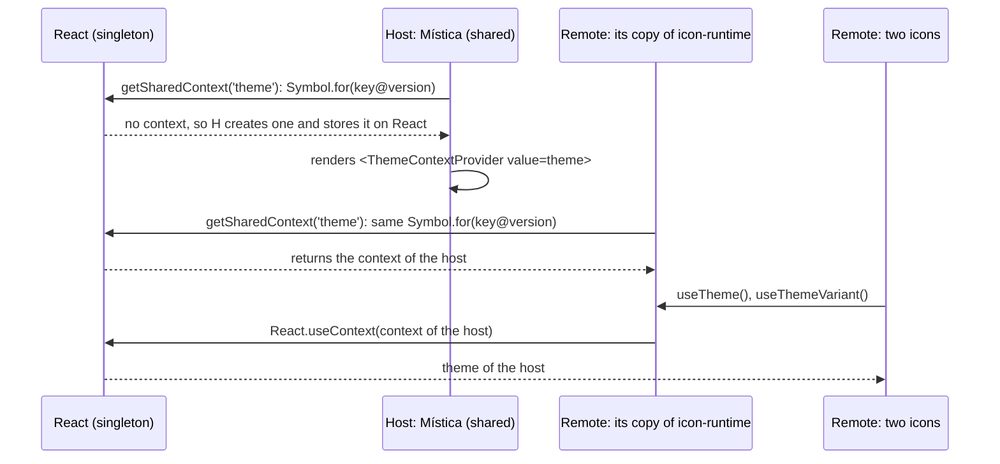

# Mistica and Module Federation

This page explains how to consume Mística from a host that uses
[webpack Module Federation](https://webpack.js.org/plugins/module-federation-plugin/).

## Configuration of a host

```js
new ModuleFederationPlugin({
  name: 'host',
  remotes: {
    /* ... */
  },
  shared: {
    react: {singleton: true},
    'react-dom': {singleton: true},
    '@telefonica/mistica': {singleton: true},
  },
});
```

`@telefonica/mistica` needs `singleton: true`, because it holds React contexts. Two copies of the theme
context break the theme, the dialogs and the snackbars.

The icons of `@telefonica/mistica-icons` read the theme through `@telefonica/mistica/icon-runtime`, and the
line above does not share that path. A remote therefore evaluates its own copy of the theme modules. That copy
is safe: the theme context and the theme variant context live on the React singleton, under a key that holds
the version of Mística, so every copy of those modules reads the provider of the host.



## Share `@telefonica/mistica/icon-runtime` or not

Both choices render correctly. The only difference is the size:

| `shared` for the entry point                            | Example page | Requests | When to choose it                       |
| ------------------------------------------------------- | ------------ | -------- | --------------------------------------- |
| none (**recommended**)                                  | 1846.5 kB    | 12       | Default. One line less to keep in sync. |
| `'@telefonica/mistica/icon-runtime': {singleton: true}` | 1803.1 kB    | 12       | You need the 43 kB that the copy costs. |

Without the line, each application bundles its own copy of the entry point, a few leaf modules with no state
of their own. With the line, the page loads one copy only.

### The icons need a prefix, or no sharing at all

`@telefonica/mistica-icons` has no entry point on purpose, so this **fails**:

```js
// the container finds no module to provide
shared: {'@telefonica/mistica-icons': {}}
```

**Leave the icons out of the `shared` list.** Each application then bundles the icons that it uses. An icon
holds no state, so a second copy of one icon is safe, and it costs a few hundred bytes.

The other configuration, a shared path prefix, also works, but it costs more than it saves:

```js
// measured: the page makes 65 requests with this line, and 12 without it
shared: {
    '@telefonica/mistica': {singleton: true},
    '@telefonica/mistica-icons/': {},
}
```

The trailing slash shares each module under the prefix on its own, so webpack emits one shared module, one
chunk and one fallback copy for each icon, including the 52 icons that the components of Mística render
themselves.

## Requirements of the icons package

The icons package declares its modules with an `exports` map, so a consumer needs:

- webpack 5, Vite, Rspack or another bundler that reads the `exports` field;
- Jest 28 or later, if the tests import an icon;
- TypeScript with `moduleResolution` set to `bundler`, `node16` or `nodenext`. A project that still uses
  `moduleResolution: node` resolves the types through the `typesVersions` field of the package, which covers
  the same paths.

## Migration

The codemod in [codemods/mistica-icons-codemod.js](../codemods/mistica-icons-codemod.js) helps to rewrite
every icon import of a codebase:

```bash
yarn add @telefonica/mistica-icons
npx jscodeshift -t codemods/mistica-icons-codemod.js --parser=tsx --extensions=tsx,ts src
```

Before:

```tsx
import {ButtonPrimary, IconStarRegular} from '@telefonica/mistica';
```

After:

```tsx
import {ButtonPrimary} from '@telefonica/mistica';
import IconStarRegular from '@telefonica/mistica-icons/icon-star-regular';
```

The icon metadata moved as well:

```tsx
// before: import {iconKeywords, iconCategories} from '@telefonica/mistica';
import {iconKeywords, iconCategories} from '@telefonica/mistica-icons/keywords';
```
