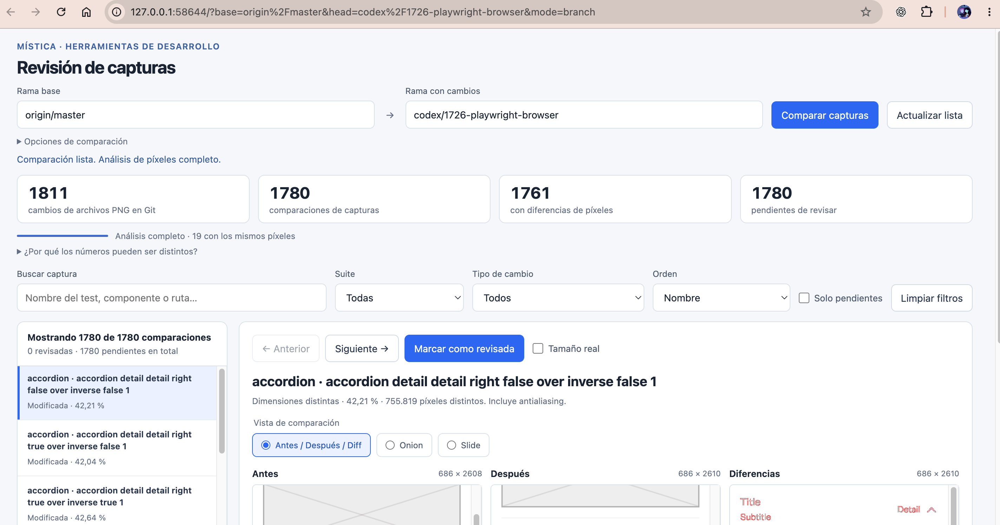

# Screenshot review



Run a local viewer for the PNG references in two Git revisions:

```sh
yarn install
git fetch origin
yarn review-screenshots
```

Open the URL printed in the terminal. Choose the base branch (for example, `origin/master`) and the branch
with changes. Both local and remote-tracking branch names are supported. A tag or commit SHA also works. The
viewer reads your clone; it does not change branches, update tests or upload images.

You can preselect a comparison or use another clone:

```sh
yarn review-screenshots --base origin/master --head origin/my-feature
node scripts/review-screenshots/server.js --repo /path/to/mistica-web
```

By default, the comparison starts from the common ancestor, like a pull request. Choose **Comparar las dos
versiones directamente** to compare the selected revisions themselves, including unrelated changes on the base
branch.

## Review

- Inspect the original, updated and diff images side by side. Red pixels include antialiasing changes.
- Switch to **Onion** to overlay the updated image with adjustable opacity, or **Slide** to reveal it with a
  movable divider. Drag on the image or adjust the slider with the mouse or keyboard. Both views align images
  at their original top-left corner and preserve their proportions, including when dimensions differ. They
  require both an original and an updated image; additions and deletions use the side-by-side view.
- Search by component, test name or path. Filter by suite, change type or pending reviews.
- Use **Tamaño real** to inspect pixels without resizing.
- Mark reviewed images; use the arrow keys to navigate and **R** to toggle a review.
- Progress is saved under `reports/screenshot-review/`, which Git ignores. It survives server restarts and
  remains valid across commits when the compared image contents and paths have not changed.

The viewer recognizes the existing `__image_snapshots__` directories and also supports
`__playwright_snapshots__` if another branch uses that convention. It does not create or move those folders.
Added Playwright references can be compared against the corresponding legacy image when the match is
unambiguous. Ambiguous additions and deletions remain separate so no changed file disappears from the review.

## Counts

The summary distinguishes:

- **Cambios de archivos PNG en Git**: changed snapshot files, using Git's rename detection.
- **Comparaciones de capturas**: before/after pairs. A renamed image can form one pair from an addition and a
  deletion, so this count can differ from Git's file count.
- **Con diferencias de píxeles**: pairs whose decoded pixels differ. This count fills in as analysis runs. A
  reencoded PNG can have different bytes and identical pixels.
- **Pendientes de revisar**: pairs you have not marked as reviewed, across the whole comparison.
- **Mostrando X de Y**: results matching the current filters, out of all comparisons.
- **Página X de Y**: pages of up to 25 captures, not an image count.

Non-image changes in the PR are counted separately in **¿Por qué los números pueden ser distintos?**. Images
that cannot be decoded are shown as errors rather than silently omitted.

## Sharing with the team

Share the script through the repository. Each teammate runs the same command in their own clone and selects
the branches they want to review. The server listens only on the local computer and uses no GitHub token. It
is a local tool, not a hosted site; sharing a localhost URL does not give another person access to it.

## Checks

```sh
yarn test-screenshot-review
```

The tests cover Git merge-base comparisons, renamed paths, staged references, ambiguous matches, pixel counts,
image dimensions, saved review state and the local HTTP endpoints.
